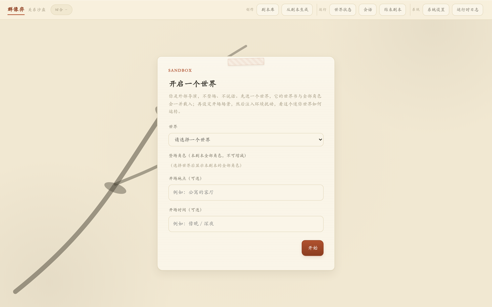
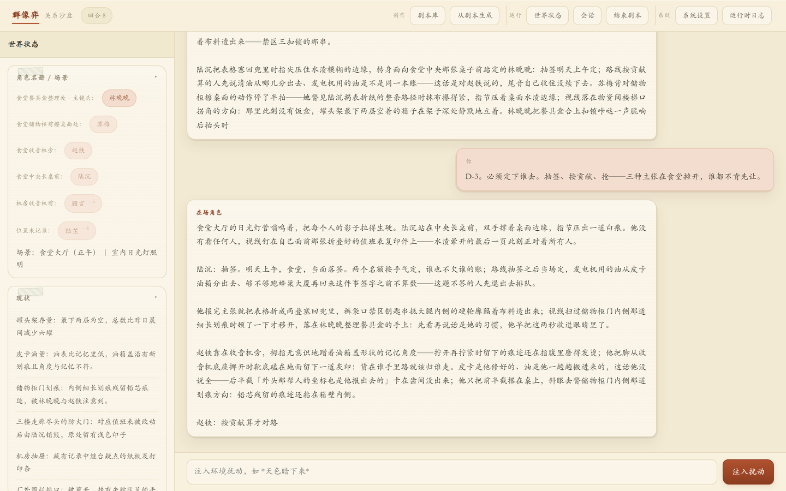
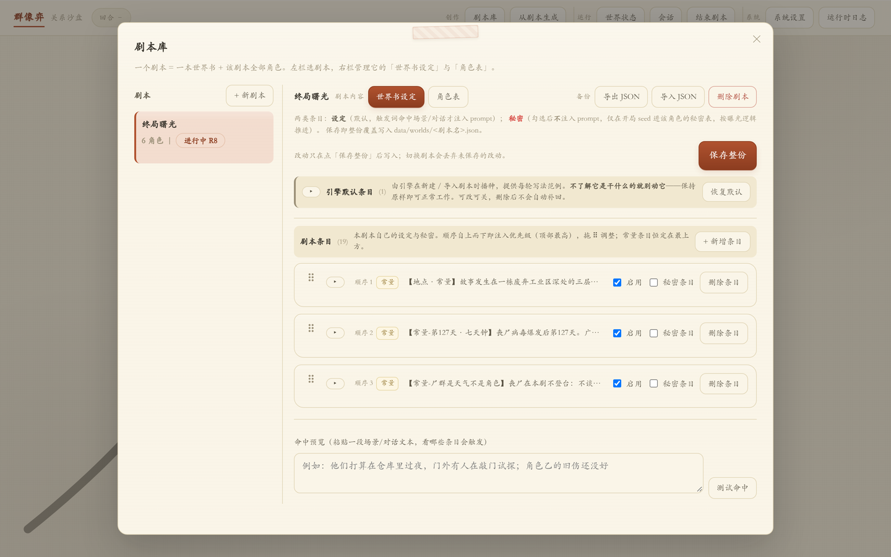
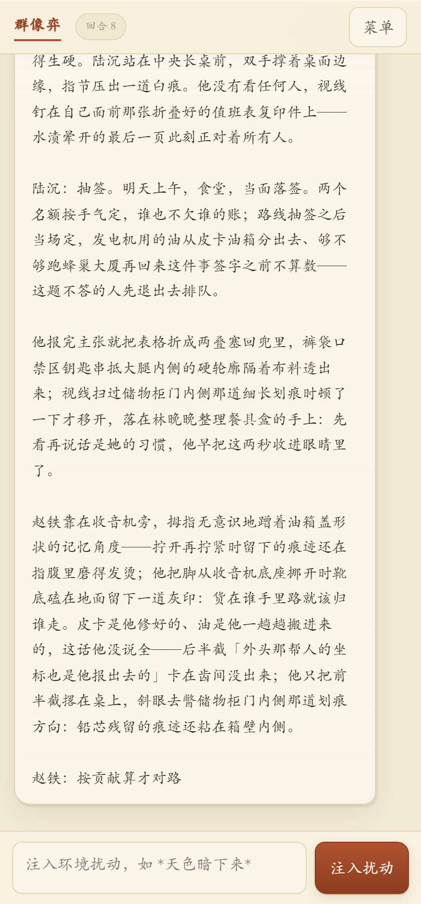

# 群像弈（Personae）

一个原创的**多角色关系沙盘**引擎：Flask + 大模型驱动的剧情推演工具，自带世界书、秘密机制、关系网演化与多角色叙事推演。

本引擎为原创 Python/Flask 实现，设计参考开放的角色卡 / 世界书理念，未使用 SillyTavern 等任何第三方源代码。

## 界面预览

开局首屏——选择剧本与开场场景，导演由此入场：



推演主界面——左栏世界状态（名册 / 现状 / 人物位置 / 秘密簿记），中央多角色叙事流，底部注入环境扰动：



剧本库——一本剧本 = 一本世界书 + 该剧本全部角色，条目支持常量 / 秘密 / 递归依赖设定：



移动端适配（窄屏单列布局）：



截图基于随包官方 demo 剧本，仅展示界面形态；实际推演内容由所接模型决定。

## 定位与设计理念

- **群像缠斗，没有主角**：引擎不为单一主角服务。开局名册即剧本全部角色，张力来自角色之间的关系网、目标冲突与秘密博弈，而非单人养成。
- **秘密是一等机制**：每个秘密绑定持有者，初始「潜伏」；剧情真正写出"发现动作 + 事实"才翻「暴露」，状态变化持续驱动后续博弈。关系与秘密的簿记（而非模型自身的长程记忆）是引擎的核心能力。
- **世界书是环境杠杆**：通过关键词命中、常量注入、注入位置（系统层前 / 历史后）与递归依赖，把设定精确投喂给模型，用"位置"而非"力度"撬动叙事。
- **外部导演范式**：使用者是不登场的导演，只向场景注入扰动；角色由模型自主决策行动。
- **模型无关**：任何 OpenAI 兼容接口皆可对接（本地 llama.cpp / 云端服务均可）。
- **零依赖负担**：数据为本地 JSON / JSONL，无数据库；前端单页原生 JS，无构建步骤。

## 快速开始

完整安装步骤见 [`engine/INSTALL.md`](engine/INSTALL.md)。最简路径：

```bash
cd engine
install.bat            # 建 venv 并装依赖（Flask / requests）
run.bat                # 启动，默认 http://127.0.0.1:5051
```

浏览器打开对应地址，顶部四个面板：

- **角色库**：新建 / 编辑 / 删除角色卡（支持导入外部 JSON，未识别字段保留）
- **世界书**：编辑世界书条目（浏览器内 `/docs/worldbook` 有完整用户手册）
- **会话**：列出 / 继续 / 放弃进行中的剧本
- **系统设置**：LLM 后端连接与生成参数，世界书说明书内链

引擎自带官方 demo 剧本（`engine/data/examples/`），首次运行自动播种，可直接开局体验。

## 核心机制速览

- **世界书**：关键词命中注入；`constant` 每轮必注；`depth` 条目级扫描深度；`position` 注入位置（before 系统层 / after 历史后）；`#name#` 递归拉入依赖条目。
- **秘密机制**：秘密四态（潜伏 / 起疑 / 暴露 / 已公开），由剧情中的看见、听见、被告知、发现物证、自述、承认等通道驱动状态迁移。
- **关系网 / 目标**：每轮由导演模块从叙事回写（actions / goals / relations）；亲缘关系独立冻结，不被长轮对话覆盖。
- **名册与分场**：开局名册固定为剧本全部角色（少人会让关系网、秘密归属、亲缘、目标出现悬空引用）；生成后剥离名册外角色的台词；「谁在场」由 `locations` 分场表达，不靠名册收缩。

## 引擎目录

```
engine/
├── app.py          服务入口：路由 + SSE 流式转发
├── director.py     导演简报：秘密状态机 / 名册校验 / 关系与镜头推断
├── world.py        世界书扫描（constant / depth / position / recursive）
├── prompter.py     提示词分层组装
├── memory.py       会话 / 快照 / 秘密种子 / 行动状态
├── store.py        角色卡 / 世界书 / 聊天 的本地文件读写
├── llm.py          模型后端接入（OpenAI 兼容）
├── scene.py        场景自动切换（时间 / 天气 / 在场名单）
├── hooks.py        钩子（prompt_ready / message_received）
├── data/           角色卡 / 世界书 / 配置 / 随包 demo 剧本
├── static/         单页前端 + 世界书用户手册
├── run.bat  install.bat  requirements.txt
├── INSTALL.md      安装指南（面向使用者，先看这个）
├── README.md       引擎说明
└── VERSION         版本号
```

引擎即 `engine/` 目录本身，独立自足：只含运行所需的一切与面向使用者的说明。

## 版本

当前版本见 [`engine/VERSION`](engine/VERSION)。

## 许可证

本项目（含引擎源码与随包剧本内容）采用 **GNU GPL v3 或更高版本**（GPL-3.0-or-later）开源，全文见 [`LICENSE`](LICENSE)。自由使用、复制、修改与再分发，衍生作品须以相同许可证开源。

Copyright (C) 2026 co2co
