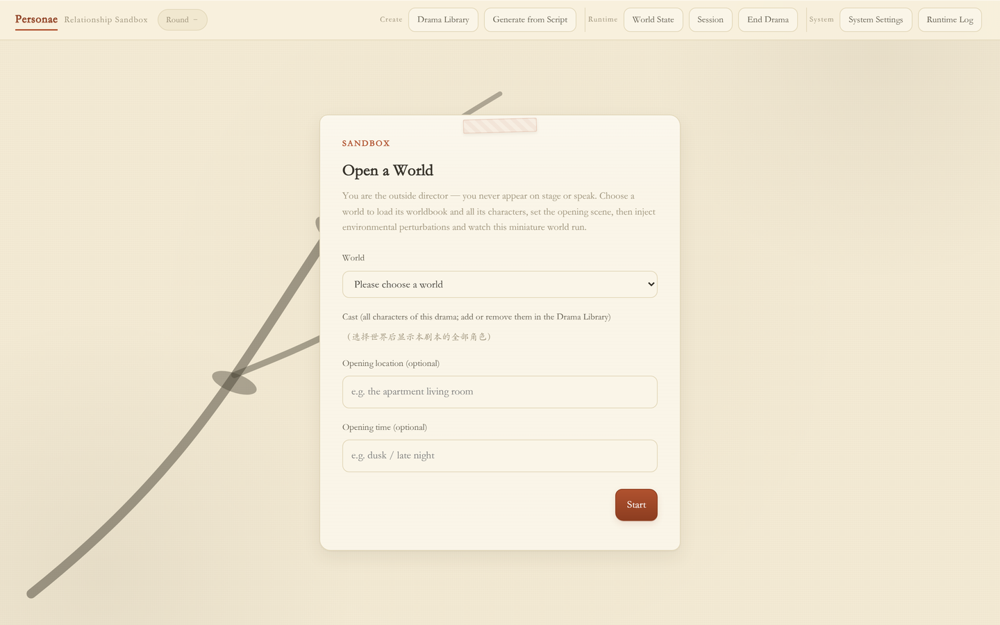
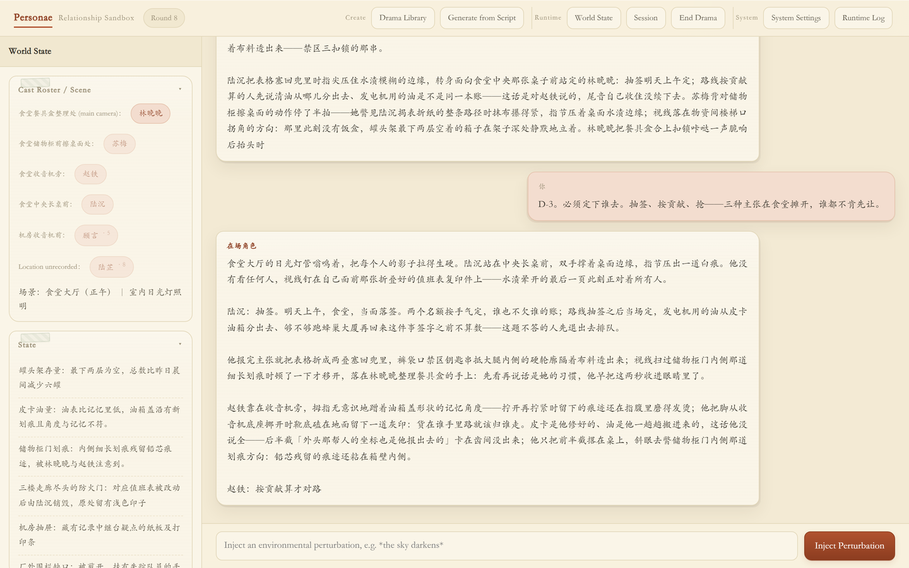
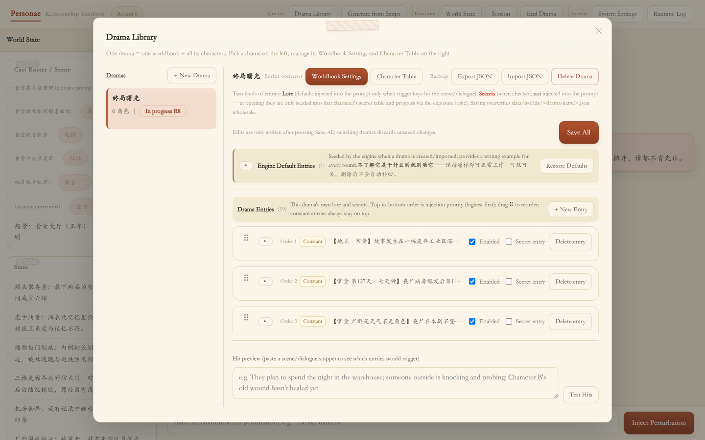
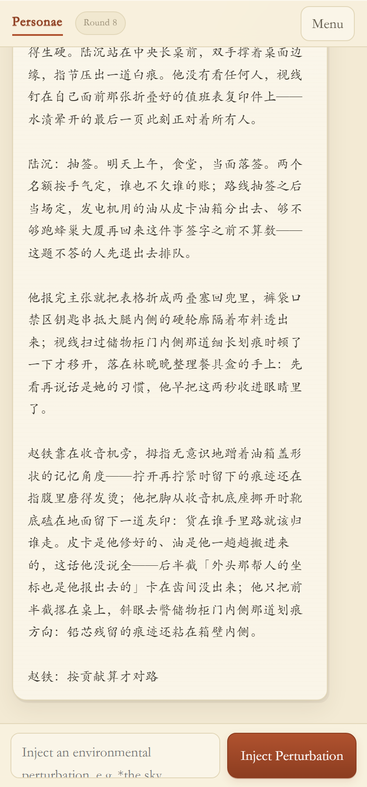

<p align="center">
  <b>English</b> | <a href="README.zh-CN.md">简体中文</a>
</p>

# Personae（群像弈）

An original **multi-character relationship sandbox** engine: a story-simulation tool driven by Flask and a large language model, with a built-in worldbook, secret mechanics, relationship-network evolution, and multi-character narrative simulation.

This engine is an original Python/Flask implementation. Its design draws on the open character-card and worldbook concepts; no third-party source code such as SillyTavern is used.

## Interface Preview

Setup screen — pick a drama and an opening scene, and the director takes over from there:



Sandbox view — world state on the left (roster / current state / locations / secret ledger), multi-character narrative stream in the center, environment perturbation input at the bottom:



Drama library — one drama is one worldbook plus all the characters in that drama; entries support constant / secret / recursive dependency settings:



Mobile layout (single-column on narrow screens):



The interface follows your system language by default (Chinese systems get Chinese, everything else English). You can override it under System Settings → Interface Language — 中文 / English / Auto, where Auto goes back to following the system. This covers the whole UI, including the left rail's world state, roster, and secret ledger. These screenshots use the UI in English; the [Chinese README](README.zh-CN.md) shows the Chinese UI.

Screenshots are taken from the bundled official demo drama and show the interface only; actual simulation content depends on the connected model.

## Positioning and Design Principles

- **Ensemble conflict, no protagonist**: the engine does not serve a single lead. The opening roster is every character in the drama; tension comes from the relationship network, conflicting goals, and secret maneuvering among characters, not from raising one character.
- **Secrets are a first-class mechanic**: every secret is bound to a holder and starts as "latent". It only flips to "exposed" when the narrative actually writes a discovery action plus a fact, and that state change keeps driving later play. Bookkeeping of relationships and secrets — rather than the model's own long-range memory — is the engine's core capability.
- **The worldbook is an environmental lever**: keyword matching, constant injection, injection position (before the system layer / after history), and recursive dependencies feed the model exactly the setting it needs, leveraging position rather than force.
- **External director paradigm**: the user is a director who never enters the scene and only injects perturbations; characters decide their own actions through the model.
- **Model-agnostic**: any OpenAI-compatible endpoint works (local llama.cpp or a cloud service).
- **No dependency burden**: data lives in local JSON / JSONL files, no database; the frontend is a single page of vanilla JavaScript with no build step.

## Quick Start

Full installation steps are in [`engine/INSTALL.md`](engine/INSTALL.md). Shortest path:

```bash
cd engine
install.bat            # create venv and install deps (Flask / requests)
run.bat                # start, default http://127.0.0.1:5051
```

Open the address in a browser; the top bar has four panels:

- **Character Library**: create / edit / delete character cards (imports external JSON, preserving unrecognized fields)
- **Worldbook**: edit worldbook entries (a full user manual is at `/docs/worldbook` in the browser)
- **Sessions**: list / resume / abandon dramas in progress
- **System Settings**: LLM backend connection and generation parameters, plus a link to the worldbook manual

The engine ships with an official demo drama (`engine/data/examples/`); it is seeded automatically on first run, so you can start playing right away.

## Core Mechanics at a Glance

- **Worldbook**: keyword-triggered injection; `constant` entries are injected every round; `depth` sets per-entry scan depth; `position` sets the injection point (before the system layer / after history); `#name#` recursively pulls in dependent entries.
- **Secret mechanic**: four secret states (latent / suspected / exposed / public), with transitions driven by narrative channels such as seeing, overhearing, being told, finding evidence, self-disclosure, and admission.
- **Relationship network / goals**: every round the director module writes back actions / goals / relations from the narrative; kinship is frozen separately and is never overwritten by long conversations.
- **Roster and location staging**: the opening roster is fixed to every character in the drama (dropping anyone leaves dangling references in the relationship network, secret ownership, kinship, and goals); lines from characters outside the roster are stripped after generation; "who is present" is expressed through `locations` staging, not by shrinking the roster.

## Engine Layout

```
engine/
├── app.py          entry point: routes + SSE streaming passthrough
├── director.py     director briefing: secret state machine / roster checks / relations and focus inference
├── world.py        worldbook scanning (constant / depth / position / recursive)
├── prompter.py     layered prompt assembly
├── memory.py       sessions / snapshots / secret seeds / action state
├── store.py        local file I/O for character cards / worldbook / chats
├── llm.py          model backend integration (OpenAI-compatible)
├── scene.py        automatic scene switching (time / weather / present roster)
├── hooks.py        hooks (prompt_ready / message_received)
├── data/           character cards / worldbook / config / bundled demo drama
├── static/         single-page frontend + worldbook user manual
├── run.bat  install.bat  requirements.txt
├── INSTALL.md      install guide (for users, read this first)
├── README.md       engine documentation
└── VERSION         version number
```

The engine is the `engine/` directory itself and is self-contained: it holds everything needed to run plus the documentation written for its users.

## Version

See [`engine/VERSION`](engine/VERSION) for the current version.

## License

This project (engine source and bundled drama content) is released under the **GNU GPL v3 or later** (GPL-3.0-or-later); the full text is in [`LICENSE`](LICENSE). Use, copy, modify, and redistribute freely; derivative works must be open-sourced under the same license.

Copyright (C) 2026 co2co
